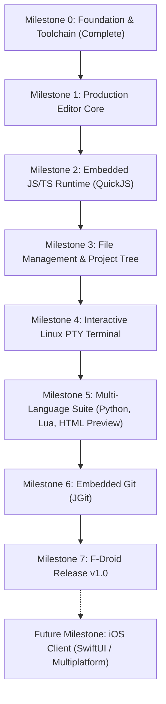

# Anyvil Delivery Roadmap & Sustainability Model (Phase E)

This roadmap outlines the milestones, risks, and financial sustainability for Anyvil.

---

## 1. Milestones Overview

### Detailed Milestone Breakdown

| Milestone | Target Deliverable | Verification Criteria |
| :--- | :--- | :--- |
| **M0: Foundation (Current)** | Stabilized toolchain, clean Anyvil package identity, documentation pushed to GitHub. | `./gradlew assembleDebug` passes in <15s on-device. |
| **M1: Production Editor Core** | High-performance text canvas, custom gutter, line wrapping, cursor touch handles, 48dp keyboard symbol row. | Smooth 60fps scrolling on a 10,000-line source file. |
| **M2: Embedded Execution (JS/TS)** | Real JNI-linked QuickJS engine. Clicking `▶ Run` executes `main.js` on-device with zero network and streams stdout/stderr to bottom sheet. | `console.log()` outputs in <20ms without spawning external shell processes. |
| **M3: Workspace Tree** | Hierarchical file browser sheet, multi-file switching, internal project sandbox creation, SAF external export. | Read/write operations verified with mock and real disk files. |
| **M4: Native PTY Terminal** | Linux `/dev/pts` allocation via JNI, ANSI escape color rendering, interactive keyboard input. | Interactive shell commands execute smoothly on phone. |
| **M5: Multi-Language Suite** | Embedded Lua 5.4, Python execution, live HTML/CSS/JS preview in sandboxed WebView. | Test scripts in JS, Lua, and HTML execute cleanly offline. |
| **M6: Embedded Git** | JGit integration for local commit, status, branch, and remote push/pull over HTTPS/SSH. | Create commit and push to GitHub directly from inside Anyvil app. |
| **M7: F-Droid v1.0** | Reproducible build metadata, public signing, metadata assets, F-Droid repository submission. | Passes `fdroid lint` and builds cleanly on clean build servers. |

---

## 2. Risk & Mitigation Matrix

| Risk | Severity | Mitigation Strategy |
| :--- | :---: | :--- |
| **Android 14+ Execution Restrictions** | **High** | Package all native binaries inside APK `jniLibs/`. Android's installer guarantees executable permissions in the native library directory. |
| **Mobile Memory Pressure (OOM)** | **Medium** | Implement piece-table or rope data structures for large files instead of loading raw Strings into Compose state. |
| **Touch Precision & Fatigue** | **Medium** | Minimum 48dp tap targets for all symbol buttons; cursor nudge keys on helper row to avoid finger-blocking text. |
| **F-Droid Build Strictness** | **Low** | Strictly maintain zero proprietary SDKs or binary blobs in git; use only verified Maven Central / Google dependencies. |

---

## 3. Financial Sustainability & "Free Forever" Model

Anyvil is strictly non-commercial, telemetry-free, and ad-free.

* **Android Distribution:** F-Droid is free, public, and run by the open-source community. Hosting cost is **$0**.
* **Continuous Integration:** GitHub Actions provides free runners for public open-source repositories. CI cost is **$0**.
* **Future iOS Expansion:** When iOS is addressed, the Apple Developer Program fee ($99/year) will be financed exclusively through voluntary open-source donations (e.g., GitHub Sponsors, LiberaPay) without ever introducing paywalls, telemetry, or advertisements into the software.
